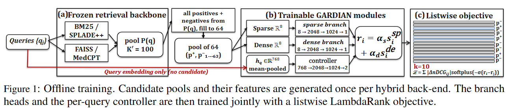
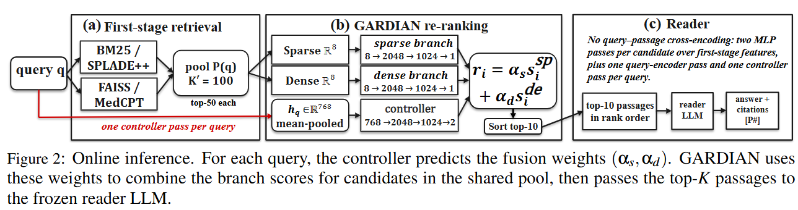

# GARDIAN: Learned Fusion of Sparse and Dense Evidence for Biomedical RAG

GARDIAN learns passage relevance from the evidence produced by sparse and dense retrievers. Two scoring branches transform retrieval features into relevance scores, and a query-level controller combines them. The resulting ranking supplies the evidence for a frozen language-model reader, without running a cross-encoder over every query–passage pair.

This repository documents the completed PubMedQA and MedMCQA experiments saved in `results/`: four hybrid retrieval backends, five-seed training and retrieval evaluation, fusion ablations, LambdaMART and cross-encoder comparisons, end-to-end QA, and cost measurements. The main experimental distinction is between learning the branch scores and choosing their fusion weight; both are evaluated in the saved artifacts.

## Contents

- [Architecture](#architecture)
- [Installation](#installation)
- [Repository layout](#repository-layout)
- [Data and retrieval backends](#data-and-retrieval-backends)
- [Complete training and evaluation workflow](#complete-training-and-evaluation-workflow)
- [End-to-end question answering](#end-to-end-question-answering)
- [Experiments and saved results](#experiments-and-saved-results)
- [Configuration](#configuration)
- [Validation and tests](#validation-and-tests)
- [Troubleshooting](#troubleshooting)
- [Scope and limitations](#scope-and-limitations)
- [License](#license)

## Architecture

### Offline training



Candidate pools and features are prepared once for each hybrid backend. Training groups retain the positives and sample negatives to form groups of 64 candidates. The two relevance branches and controller are trained jointly with LambdaRank at cutoff 10.

### Online inference



Each channel retrieves its top 50 passages, forming a union of up to 100 candidates. GARDIAN scores the stored first-stage features and combines the learned branch outputs using one set of weights per query. The top 10 passages are passed to the reader in rank order. The controller uses a mean-pooled query embedding; candidates are not cross-encoded with the query.

For a query `q` and candidate passage `p`, the default model computes:

```text
s_sparse = SparseBranch(sparse_features(q, p))
s_dense  = DenseBranch(dense_features(q, p))
(alpha_sparse, alpha_dense) = softmax(Controller(query_embedding(q)))
score(q, p) = alpha_sparse * s_sparse + alpha_dense * s_dense
```

The fusion weights sum to one and are shared across one query's candidates. The two branches and controller are separate MLPs with independent weights.

The current feature schema stores **8 sparse + 8 dense features** per candidate:

| Sparse branch | Dense branch |
| --- | --- |
| Raw retrieval score | Raw retrieval score |
| IDF-weighted token overlap | Mean absolute query/passage embedding difference |
| Token-set Jaccard similarity | Maximum absolute embedding difference |
| Within-pool min–max score | Within-pool z-score |
| Within-pool z-score | Within-pool min–max score |
| Normalized rank | Normalized rank |
| Score dispersion | Score dispersion |
| Retrieved-by-sparse indicator | Retrieved-by-dense indicator |

See [`src/features/schema.py`](src/features/schema.py) for the exact ordering and missing-score handling. Question type is an analysis label, **not a model input**. The reported configuration uses the query embedding as the controller input and leaves branch-output normalization disabled.

## Installation

Run commands from the repository root. Python **3.10 or newer** is declared in `pyproject.toml`. A Linux environment with an NVIDIA GPU is appropriate for the full indexing and LLM workflow. CPU execution is available for several stages, but large model and corpus runs require substantial time, RAM, and disk space. Requirements depend on corpus size, reader size, precision, and batch sizes; this repository does not establish a universal minimum GPU size.

```bash
cd gardian
python3 -m venv .venv
source .venv/bin/activate
python -m pip install --upgrade pip
```

Install a PyTorch build suitable for your machine first. For GPU work, select a CUDA-compatible build and confirm CUDA availability after installing the remaining dependencies:

```bash
python -m pip install -r requirements.txt
python -c "import torch; print('PyTorch:', torch.__version__); print('CUDA available:', torch.cuda.is_available())"
```

The requirements include Transformers, Sentence Transformers, datasets, BM25S, CPU FAISS, OmegaConf, and plotting/test utilities. `bitsandbytes` is used for the saved 4-bit 32B-reader rerun. The documented QA runs keep FAISS on CPU.

Models and datasets download from Hugging Face when needed. If a selected model is gated, obtain access and authenticate your environment before running it. Keep tokens out of source files and commits.

Use the scripts below directly from the repository root.

## Repository layout

```text
gardian/
├── configs/base.yaml        # Shared experiment and model configuration
├── scripts/                 # Data, indexing, training, evaluation, reports, plots
├── src/
│   ├── baselines/           # Fusion baselines
│   ├── common/              # Paths, seeds, reproducibility, shared retrieval helpers
│   ├── evaluation/          # Retrieval/QA metrics, qrels, statistics, ablations
│   ├── features/            # Feature schema, construction, normalization, corpus IDF
│   ├── model/               # GARDIAN branches and controller
│   ├── pipeline/            # Retrieval, adaptive fusion, RAG reader
│   ├── retrieval/           # BM25, FAISS, SPLADE++, MedCPT, cross-encoders
│   └── training/            # Streaming training and ranking losses
├── tests/                   # Automated checks
├── docs/                    # Research notes and protocol audits
├── results/                 # Tracked checkpoints, metrics, QA outputs, reports
├── data/                    # Local corpora, indices, rank data, caches (ignored)
├── logs/                    # Local execution logs
├── requirements.txt
└── LICENSE
```

## Data and retrieval backends

The primary QA collections are PubMedQA labeled, PubMedQA artificial, and MedMCQA. MedRAG/PubMed supplies additional passages for corpus preparation. The preparation script targets a unified corpus of **3 million passages**; actual output depends on available and accepted source records. Inspect the generated report rather than assuming the target was reached.

| CLI retriever name | Sparse channel | Dense channel |
| --- | --- | --- |
| `hybrid_bm25_faiss` | BM25 | FAISS over biomedical sentence embeddings |
| `hybrid_bm25_medcpt` | BM25 | MedCPT |
| `hybrid_spladepp_faiss` | SPLADE++ | FAISS over biomedical sentence embeddings |
| `hybrid_spladepp_medcpt` | SPLADE++ | MedCPT |

The default sentence encoder is `NeuML/pubmedbert-base-embeddings`. Neural retrieval uses `naver/splade-cocondenser-ensembledistil` and the asymmetric `ncbi/MedCPT-Query-Encoder` / `ncbi/MedCPT-Article-Encoder` pair. Each family needs its corresponding indices and a matching GARDIAN checkpoint.

## Complete training and evaluation workflow

These commands describe a fresh run. Existing per-seed results are protected against accidental overwrite; use a separate results directory for variants. Data preparation and index generation can be expensive and write canonical local artifacts, so do not rerun them merely to inspect saved results.

### 1. Prepare corpora and question splits

```bash
python scripts/00_download_data.py
```

This creates local corpus and QA JSONL files under `data/`, including per-collection corpora and a unified corpus. Passage records carry identifiers and text; question records carry question/answer information and gold passage IDs used for supervision.

### 2. Build retrieval indices

For BM25 + FAISS:

```bash
python scripts/01_build_bm25_faiss_indices.py --dataset all
```

This builds the available primary corpora and the unified index. To restrict work to one corpus or channel:

```bash
python scripts/01_build_bm25_faiss_indices.py --dataset medmcqa --only bm25
python scripts/01_build_bm25_faiss_indices.py --dataset medmcqa --only faiss
```

For experiments using SPLADE++ or MedCPT:

```bash
python scripts/01_build_spladepp_medcpt_indices.py --dataset all --only all
```

### 3. Generate ranking data

Start with one hybrid family:

```bash
python scripts/03_generate_rank_data.py \
  --retriever hybrid_bm25_faiss \
  --mode per-corpus \
  --device auto --no-faiss-gpu
```

The script retrieves candidates, computes features, and labels a candidate positive when its passage ID belongs to the query's gold evidence. The configured search depths are 50 sparse + 50 dense, with a union capped at 100 candidates. Generated rank data uses paths such as:

```text
data/hybrid_bm25_faiss/rank_data_hybrid_bm25_faiss_<dataset>_<split>.jsonl
```

Use `--retriever all` to generate all four hybrid families after building their indices. `--dataset` restricts the collection. `--max-queries` supports small development runs, but writes canonical paths; the script refuses substantial shrinking of an existing file unless explicitly allowed.

Ranking data uses the full dense feature computation. Corpus IDF is shared through `src/features/idf.py` so offline and live QA features agree.

### 4. Train GARDIAN

A single-family, single-seed run:

```bash
python scripts/04_train_gardian.py \
  --retriever hybrid_bm25_faiss --seeds 42
```

A complete configured run:

```bash
python scripts/04_train_gardian.py \
  --retriever all --seeds 13 21 42 87 100
```

The default training collections are PubMedQA artificial, MedMCQA, and PubMedQA labeled where their training files exist. Training combines source files; evaluation splits remain separate. Current defaults include LambdaRank loss, learning rate `1e-3`, 10 epochs, 64 queries per listwise batch, and up to 64 candidates per training group. The best checkpoint is selected using development `nDCG@10`.

Artifacts include:

```text
results/seeds/seed_42/gardian_best_hybrid_bm25_faiss.pt
results/seeds/seed_42/gardian_training/hybrid_bm25_faiss/
```

### 5. Evaluate retrieval

Evaluation reuses precomputed candidate pools instead of rebuilding the indices:

```bash
python scripts/05_evaluate_gardian.py \
  --retriever hybrid_bm25_faiss --seeds 42 --print-hit-table
```

For the full multi-seed run:

```bash
python scripts/05_evaluate_gardian.py \
  --retriever all --seeds 13 21 42 87 100
python scripts/aggregate_seeds.py --min-seeds 5
```

Outputs under `results/aggregated/` include retrieval metrics and training summaries in JSON/CSV, with mean, standard deviation, seed counts, and raw seed values. `--min-seeds 5` detects incomplete aggregate cells; it does not generate missing experiments.

Metrics include nDCG, MRR, recall, and Hit@k. Use the full source relevance judgments and the population recorded in the output when comparing runs. Historical notes and artifacts can use different populations or binary/graded gains. Oracle-alpha uses evaluation labels and is a diagnostic ceiling, not a deployable baseline.

## End-to-end question answering

The controlled QA comparison gives hybrid RRF and GARDIAN the same candidate pool and reader, with 10 passages sent to the reader. The `--rq4` flag retains its historical name even though some newer reporting scripts call the end-to-end matrix RQ3.

The saved end-to-end matrix uses Qwen2.5 7B, 14B, and 32B readers with BM25+FAISS and SPLADE+++MedCPT. Llama-3-8B result files are also present in the original matrix. Each requested dataset is capped at 1,000 questions. For example, the corrected BM25+FAISS 7B GARDIAN run is reproduced with:

```bash
python scripts/06_end_to_end_qa.py \
  --rq4 --systems gardian \
  --online-retrieval --pubmedqa-open-domain \
  --gardian-adaptive-retrieval --faiss-cpu \
  --retriever hybrid_bm25_faiss \
  --reader-models Qwen/Qwen2.5-7B-Instruct \
  --datasets pubmedqa_labeled,pubmedqa_artificial,medmcqa \
  --max-questions 1000 --top-k-passages 10 --seed 42 \
  --checkpoint-every-dataset \
  --out results/rq3_1k_fixidf/qa_hybrid_bm25_faiss_Qwen7B_n1000.json
```

The corrected 7B and 14B files contain GARDIAN results; compare them with the matching hybrid rows in the original matrix. The corrected 32B file contains both hybrid and GARDIAN with the same quantized reader. Inspect each file’s metadata and system coverage when assembling comparisons.

Important protocol details:

- `--pubmedqa-open-domain` evaluates retrieval-based QA. The configured default `gold_context` supplies the source abstract and answers a different benchmark question.
- Rank-data mode and live index routing must match; these commands use per-corpus preparation and per-dataset live retrieval.
- With `rq4_full_union_pool: true`, enabling adaptive fusion keeps the full union candidate pool; it does not shrink it to adaptive channel budgets.
- Online GARDIAN evaluation requires the matching corpus IDF table. Missing or empty IDF input raises an error rather than silently substituting different features.
- Keep reader, context size, candidate pool, model precision, prompt, and question sample identical when comparing systems.

The script supports `--resume-from` and per-dataset checkpointing. Use a new output filename when changing the protocol; `--fresh` explicitly ignores an existing output checkpoint.

For the existing matrix workflow, inspect `scripts/run_rq3_1k.sh`. The corrected BM25/FAISS GARDIAN reruns are in `scripts/run_rq3_rerun_bm25_gardian.sh`; their outputs are saved separately in `results/rq3_1k_fixidf/`. The 32B rerun uses 4-bit loading and reruns both systems for a matching comparison:

```bash
READERS="Qwen/Qwen2.5-32B-Instruct:Qwen32B" \
SYSTEMS=hybrid,gardian EXTRA_ARGS="--load-in-4bit" \
bash scripts/run_rq3_rerun_bm25_gardian.sh
```

QA outputs contain aggregate metrics and per-question records. Answer accuracy and gold evidence in context link retrieval to reader behavior. Citation metrics depend on dataset gold IDs; they measure evidence-ID alignment rather than independent clinical fact verification. MedMCQA reporting emphasizes answer accuracy.

## Experiments and saved results

### Retrieval evaluation

The table below is transcribed from [`results/aggregated/retrieval_metrics.csv`](results/aggregated/retrieval_metrics.csv). Values are **nDCG@10 means across five seeds** (13, 21, 42, 87, 100), rounded to four decimals. The CSV retains standard deviations and individual seed scores. RRF here is the artifact’s explicit `rrf` system; the separate `hybrid` row is not substituted for it.

| Backend | Dataset | Dense | RRF | GARDIAN |
| --- | --- | ---: | ---: | ---: |
| BM25 + FAISS | PubMedQA labeled | 0.8922 | 0.8632 | 0.9066 |
| BM25 + FAISS | PubMedQA artificial | 0.7095 | 0.7245 | 0.7920 |
| BM25 + FAISS | MedMCQA | 0.3282 | 0.3941 | 0.4245 |
| BM25 + MedCPT | PubMedQA labeled | 0.9132 | 0.8772 | 0.9166 |
| BM25 + MedCPT | PubMedQA artificial | 0.7513 | 0.7541 | 0.8019 |
| BM25 + MedCPT | MedMCQA | 0.3265 | 0.3984 | 0.4248 |
| SPLADE++ + FAISS | PubMedQA labeled | 0.8922 | 0.8969 | 0.9127 |
| SPLADE++ + FAISS | PubMedQA artificial | 0.7059 | 0.7519 | 0.7941 |
| SPLADE++ + FAISS | MedMCQA | 0.3281 | 0.4373 | 0.4820 |
| SPLADE++ + MedCPT | PubMedQA labeled | 0.9133 | 0.9035 | 0.9182 |
| SPLADE++ + MedCPT | PubMedQA artificial | 0.7517 | 0.7543 | 0.8033 |
| SPLADE++ + MedCPT | MedMCQA | 0.3265 | 0.4294 | 0.4797 |

These are the values in the committed aggregate artifact. Historical summaries or paper tables may use another result selection; use the linked artifact and its protocol when citing this table.

### Completed experiment artifacts

| Experiment | Saved artifacts |
| --- | --- |
| Four-backend training and retrieval evaluation, five seeds | [`results/seeds/`](results/seeds/), [`results/aggregated/training_summary.csv`](results/aggregated/training_summary.csv), [`results/aggregated/retrieval_metrics.csv`](results/aggregated/retrieval_metrics.csv) |
| Sparse/dense branch and fusion-weight ablations | [`results/aggregated/ablation_rq2.json`](results/aggregated/ablation_rq2.json), per-seed `ablation_hybrid_*.json` |
| Fixed-fusion baselines | [`results/fusion_baselines_metrics.json`](results/fusion_baselines_metrics.json), [`results/global_alpha_metrics.json`](results/global_alpha_metrics.json), [`results/global_alpha_minmax_metrics.json`](results/global_alpha_minmax_metrics.json) |
| LambdaMART on the same features | [`results/ltr_baseline_hybrid_bm25_faiss.json`](results/ltr_baseline_hybrid_bm25_faiss.json), [`results/ltr_baseline_hybrid_spladepp_medcpt.json`](results/ltr_baseline_hybrid_spladepp_medcpt.json), backend-specific seed files and saved tree models |
| Cross-encoder quality and latency comparisons | [`results/reranker_comparison_hybrid_bm25_faiss.json`](results/reranker_comparison_hybrid_bm25_faiss.json), [`results/reranker_comparison_hybrid_spladepp_medcpt.json`](results/reranker_comparison_hybrid_spladepp_medcpt.json), matching CSVs and artificial-set subset files |
| Frozen-reader QA matrix | [`results/rq3_1k/`](results/rq3_1k/) |
| Corrected BM25+FAISS IDF QA runs | [`results/rq3_1k_fixidf/`](results/rq3_1k_fixidf/) |
| Controller-free GARDIAN-Lite training | [`results/gardian_lite/`](results/gardian_lite/) |
| Training cost and model-size measurements | [`results/rq4_cost_summary.json`](results/rq4_cost_summary.json), [`results/train_step_cost.json`](results/train_step_cost.json) |
| Comparison and cost figures | [`results/figures/`](results/figures/) |

The cost summary records an NVIDIA A40, PyTorch 2.6.0 with CUDA 12.4, 7,928,836 trainable GARDIAN parameters, and five-seed mean training times of roughly 98–102 minutes per backend. Latency comparisons are stored in the reranker comparison files; consult their timing scope, sample sizes, and GPU-contention metadata when comparing systems. Training cost, reranking latency, first-stage retrieval time, and reader generation time are separate measurements.

The learned-score contribution is tested by holding the branches fixed and comparing per-query weights with a dev-fitted fixed weight. LambdaMART provides a trained control over the same features, while cross-encoders provide a different scoring approach over query–passage text. QA outputs retain per-question records and confidence intervals so evidence retrieval and answer behavior can be examined separately.

### Reproduce the recorded analyses

After preparing the matching data and checkpoints:

```bash
# Branch and fusion-weight ablations across the configured seeds/backends.
python scripts/10_paper_run.py --device cuda --parallel-workers 1 --cuda-devices 0

# Read the corrected BM25+FAISS QA artifacts.
python scripts/report_rq3.py results/rq3_1k_fixidf/*.json
```

The 7B/14B corrected files contain only the GARDIAN arm, so a paired report needs the matching original hybrid rows as well; do not treat a missing row as a zero result. Original and corrected 32B reader precision differs, which is why the corrected 32B run includes both arms.

Implementation and experiment notes: [training objective](docs/OBJECTIVE.md), [question-type analysis](docs/QUESTION_TYPE.md), [reranking audit](docs/GARDIAN_RERANK_AUDIT.md), and [reader diagnosis](docs/RAG_DIAGNOSIS.md). Older notes describe earlier experiments; the committed result files and current configuration establish the scope of this README.

## Configuration

[`configs/base.yaml`](configs/base.yaml) is the shared configuration. Key defaults are:

| Setting | Default |
| --- | --- |
| Seeds | `13, 21, 42, 87, 100` |
| Sparse/dense retrieval depth | `50` per channel |
| Candidate union cap | `100` |
| Stored branch dimensions | `8` sparse + `8` dense |
| Query embedding dimension | `768` |
| Branch/controller hidden width | `2048` |
| Controller inputs | `query_emb` |
| Normalize branch outputs | `false` |
| Training loss / learning rate | `lambdarank` / `1e-3` |
| Epochs / listwise batch size | `10` / `64` queries |
| Training group size | `64` candidates |
| Reader context | Top `10` passages |
| Default reader | `meta-llama/Meta-Llama-3-8B-Instruct` |
| PubMedQA mode | `gold_context`; override for open-domain QA |
| QA FAISS placement | CPU |

Changing feature construction or encoder choices can require rebuilding rank data and retraining. Feature selection, controller settings, and loss changes require compatible retraining. Keep configuration and checkpoint architecture aligned.

## Validation and tests

Run automated checks from the repository root after installing dependencies:

```bash
python -m pytest tests/
```

The tests cover ranking losses, metrics, feature consistency, seed handling, training behavior, fusion baselines, and reader context/citation behavior. Runtime and model requirements vary by test.

Validate a generated rank-data file separately:

```bash
python scripts/validate_rank_jsonl.py \
  --jsonl data/hybrid_bm25_faiss/rank_data_hybrid_bm25_faiss_medmcqa_train.jsonl
```

A complete reproduction additionally requires data downloads, model downloads, indices, and experiment runs; passing unit tests alone does not reproduce the reported artifacts.

## Troubleshooting

| Symptom | What to check |
| --- | --- |
| Missing corpus/index | Run preparation and the relevant index builder; verify the selected collection and backend. |
| Missing checkpoint | Train the requested family/seed, or inspect `results/seeds/seed_<seed>/`; keep configuration compatible. |
| CUDA unavailable | Check the installed PyTorch build and driver. Use supported CPU options or install the appropriate GPU stack. |
| GPU out of memory | Reduce encoder batch sizes or reader/context size; keep QA FAISS on CPU; consider a smaller reader or supported 4-bit loading. Record changes for comparisons. |
| GPU FAISS errors with `faiss-cpu` | Use `--no-faiss-gpu` for rank generation and `--faiss-cpu` for live QA; adjust index-build configuration to CPU. |
| Hugging Face access error | Check model/dataset access, accepted terms, authentication, and network availability. |
| Existing seed artifact error | Keep the completed result or use a separate results directory; only explicitly overwrite when intended. |
| Feature width mismatch | Regenerate current 8+8 rank data and use a compatible checkpoint. |
| Missing IDF table in live QA | Ensure the selected dataset corpus exists; use the shared corpus IDF construction. |
| Different offline and live rankings | Check corpus routing, IDF, feature mode, encoder, checkpoint, and candidate pool before interpreting scores. |
| Aggregate seed count too small | Complete missing seed runs/evaluations, then aggregate again. |

## Findings and limitations

The experiments support learning separate lexical and semantic relevance scores: GARDIAN improves nDCG@10 over RRF in all 12 retrieval settings and over a development-tuned global weight in 10. Query-specific weighting adds comparatively little, with a fixed weight over the learned branches remaining within 0.7 nDCG@10 points. LambdaMART performs better in five of the six tested comparisons and costs less to train and run. GARDIAN therefore provides evidence for learned feature-based fusion, while the controller's added complexity offers limited benefit in these experiments.

Candidate coverage sets a hard limit on reranking. GARDIAN can reorder retrieved passages but cannot introduce missing evidence; 12–16% of MedMCQA questions have no annotated gold passage in their candidate pool. Incomplete annotations also limit what retrieval and citation scores can establish. Citation agreement with the gold set does not independently demonstrate that the cited passage supports the generated answer.

Retrieval evaluation covers two English biomedical benchmarks, three evaluation sets, and four hybrid backends. The end-to-end study covers two backends and three frozen Qwen2.5 readers, using a single GARDIAN checkpoint and the first 1,000 questions in each evaluation file. This sampling and the absence of a closed-book control limit conclusions about generalisation and the reader's reliance on retrieved evidence. PubMedQA accuracy improves in 11 of 12 configurations, but MedMCQA accuracy does not improve despite better evidence retrieval. Results with other reader families, languages, or clinical records remain untested.

The cross-encoder comparison also differs in training conditions: GARDIAN and LambdaMART learn from the biomedical training data, whereas the cross-encoders are used without in-domain training. On PubMedQA with SPLADE++ + MedCPT, GARDIAN is competitive with the tested cross-encoders at lower reranking latency; the strongest cross-encoders retain an advantage on MedMCQA. These findings do not establish clinical readiness, which would require clinician-led evaluation on realistic patient queries and monitoring workflows.

Further work will examine retriever-confidence features, passage-level fusion decisions, and additional biomedical evidence signals.

## License

The source code is distributed under the [MIT License](LICENSE). External datasets and pretrained models retain their own licenses and access conditions.
