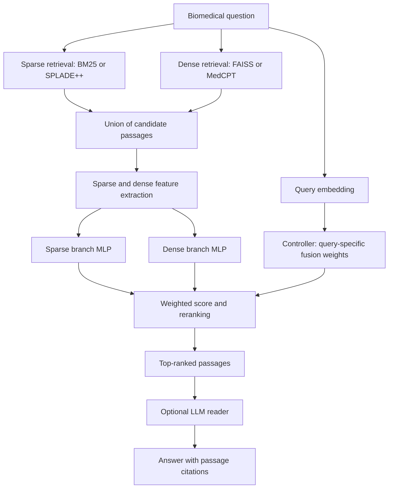

# GARDIAN

**Query-adaptive sparse–dense reranking for biomedical retrieval and retrieval-augmented question answering.**

GARDIAN retrieves a candidate pool from sparse and dense search engines, builds evidence features, and learns how to rank the passages for each question. An optional language-model reader answers using the highest-ranked passages and passage citations.

This repository contains the research workflow: dataset preparation, index construction, ranking-data generation, training, retrieval evaluation, end-to-end QA, ablations, efficiency measurements, and result reporting. It also includes saved checkpoints and experiment artifacts under `results/`. Large datasets and retrieval indices are generated locally and are excluded from Git.

## Contents

- [Architecture](#architecture)
- [Installation](#installation)
- [Repository layout](#repository-layout)
- [Data and retrieval backends](#data-and-retrieval-backends)
- [Complete training and evaluation workflow](#complete-training-and-evaluation-workflow)
- [End-to-end question answering](#end-to-end-question-answering)
- [Interactive questions and local server](#interactive-questions-and-local-server)
- [Experiments and saved results](#experiments-and-saved-results)
- [Configuration](#configuration)
- [Validation and tests](#validation-and-tests)
- [Troubleshooting](#troubleshooting)
- [Scope and limitations](#scope-and-limitations)
- [License](#license)

## Architecture



For a query `q` and candidate passage `p`, the default model computes:

```text
s_sparse = SparseBranch(sparse_features(q, p))
s_dense  = DenseBranch(dense_features(q, p))
(alpha_sparse, alpha_dense) = softmax(Controller(query_embedding(q)))
score(q, p) = alpha_sparse * s_sparse + alpha_dense * s_dense
```

The fusion weights sum to one and are shared across one query's candidates. The two branches and controller are separate MLPs with independent weights.

The current feature schema stores **8 sparse + 8 dense features** per candidate:

| Sparse branch | Dense branch |
| --- | --- |
| Raw retrieval score | Raw retrieval score |
| IDF-weighted token overlap | Mean absolute query/passage embedding difference |
| Token-set Jaccard similarity | Maximum absolute embedding difference |
| Within-pool min–max score | Within-pool z-score |
| Within-pool z-score | Within-pool min–max score |
| Normalized rank | Normalized rank |
| Score dispersion | Score dispersion |
| Retrieved-by-sparse indicator | Retrieved-by-dense indicator |

See [`src/features/schema.py`](src/features/schema.py) for the exact ordering and missing-score handling. Question type is an analysis label, **not a model input**. Optional controller inputs and branch normalization support ablation experiments; the default controller uses the query embedding.

## Installation

Run commands from the repository root. Python **3.10 or newer** is declared in `pyproject.toml`. A Linux environment with an NVIDIA GPU is appropriate for the full indexing and LLM workflow. CPU execution is available for several stages, but large model and corpus runs require substantial time, RAM, and disk space. Requirements depend on corpus size, reader size, precision, and batch sizes; this repository does not establish a universal minimum GPU size.

```bash
git clone https://github.com/Abderraouf-Naji/gardian.git
cd gardian
python3 -m venv .venv
source .venv/bin/activate
python -m pip install --upgrade pip
```

Install a PyTorch build suitable for your machine first. For GPU work, select a CUDA-compatible build and confirm CUDA availability after installing the remaining dependencies:

```bash
python -m pip install -r requirements.txt
python -c "import torch; print('PyTorch:', torch.__version__); print('CUDA available:', torch.cuda.is_available())"
```

The requirements include Transformers, Sentence Transformers, datasets, BM25S, CPU FAISS, OmegaConf, and plotting/test utilities. `bitsandbytes` supports the optional 4-bit reader path on compatible systems. Native GPU FAISS is optional and is not provided by `faiss-cpu`.

Models and datasets download from Hugging Face when needed. If a selected model is gated, obtain access and authenticate your environment before running it. Keep tokens out of source files and commits.

Use the scripts below directly from this checkout. The packaging metadata declares a `gardian-rerank` entry point, but its target module is absent in this snapshot; it is not the documented execution path.

## Repository layout

```text
gardian/
├── configs/base.yaml        # Shared experiment and model configuration
├── scripts/                 # Data, indexing, training, evaluation, reports, plots
├── src/
│   ├── baselines/           # Fusion baselines
│   ├── common/              # Paths, seeds, reproducibility, shared retrieval helpers
│   ├── evaluation/          # Retrieval/QA metrics, qrels, statistics, ablations
│   ├── features/            # Feature schema, construction, normalization, corpus IDF
│   ├── model/               # GARDIAN branches and controller
│   ├── pipeline/            # Retrieval, adaptive fusion, RAG reader
│   ├── retrieval/           # BM25, FAISS, SPLADE++, MedCPT, cross-encoders
│   └── training/            # Streaming training and ranking losses
├── tests/                   # Automated checks
├── docs/                    # Research notes and protocol audits
├── results/                 # Tracked checkpoints, metrics, QA outputs, reports
├── data/                    # Local corpora, indices, rank data, caches (ignored)
├── logs/                    # Local execution logs
├── requirements.txt
└── LICENSE
```

## Data and retrieval backends

The primary QA collections are PubMedQA labeled, PubMedQA artificial, and MedMCQA. MedRAG/PubMed supplies additional passages for corpus preparation. The preparation script targets a unified corpus of **3 million passages**; actual output depends on available and accepted source records. Inspect the generated report rather than assuming the target was reached.

Optional BEIR conversion supports TREC-COVID, NFCorpus, and SciFact. TREC-COVID is used as an explicit evaluation-only collection and is excluded from the default QA training collections.

| CLI retriever name | Sparse channel | Dense channel |
| --- | --- | --- |
| `hybrid_bm25_faiss` | BM25 | FAISS over biomedical sentence embeddings |
| `hybrid_bm25_medcpt` | BM25 | MedCPT |
| `hybrid_spladepp_faiss` | SPLADE++ | FAISS over biomedical sentence embeddings |
| `hybrid_spladepp_medcpt` | SPLADE++ | MedCPT |

The default sentence encoder is `NeuML/pubmedbert-base-embeddings`. Neural retrieval uses `naver/splade-cocondenser-ensembledistil` and the asymmetric `ncbi/MedCPT-Query-Encoder` / `ncbi/MedCPT-Article-Encoder` pair. Each family needs its corresponding indices and a matching GARDIAN checkpoint.

## Complete training and evaluation workflow

These commands describe a fresh run. Existing per-seed results are protected against accidental overwrite; use a separate results directory for variants. Data preparation and index generation can be expensive and write canonical local artifacts, so do not rerun them merely to inspect saved results.

### 1. Prepare corpora and question splits

```bash
python scripts/00_download_data.py
```

This creates local corpus and QA JSONL files under `data/`, including per-collection corpora and a unified corpus. Passage records carry identifiers and text; question records carry question/answer information and gold passage IDs used for supervision.

Optional BEIR collections are downloaded separately:

```bash
python scripts/00b_download_beir.py --dataset trec_covid
python scripts/00b_download_beir.py --dataset nfcorpus --stats-only
python scripts/00b_download_beir.py --dataset scifact
```

`--stats-only` inspects label density without writing converted corpus/query files. BEIR conversion preserves relevance grades when available.

### 2. Build retrieval indices

For BM25 + FAISS:

```bash
python scripts/01_build_bm25_faiss_indices.py --dataset all
```

This builds the available primary corpora and the unified index. To restrict work to one corpus or channel:

```bash
python scripts/01_build_bm25_faiss_indices.py --dataset medmcqa --only bm25
python scripts/01_build_bm25_faiss_indices.py --dataset medmcqa --only faiss
```

For experiments using SPLADE++ or MedCPT:

```bash
python scripts/01_build_spladepp_medcpt_indices.py --dataset all --only all
```

Optional collections require explicit index commands, for example:

```bash
python scripts/01_build_bm25_faiss_indices.py --dataset trec_covid
```

### 3. Generate ranking data

Start with one hybrid family:

```bash
python scripts/03_generate_rank_data.py \
  --retriever hybrid_bm25_faiss \
  --mode per-corpus \
  --device auto --no-faiss-gpu
```

The script retrieves candidates, computes features, and labels a candidate positive when its passage ID belongs to the query's gold evidence. The configured search depths are 50 sparse + 50 dense, with a union capped at 100 candidates. Generated rank data uses paths such as:

```text
data/hybrid_bm25_faiss/rank_data_hybrid_bm25_faiss_<dataset>_<split>.jsonl
```

Use `--retriever all` to generate all four hybrid families after building their indices. `--dataset` restricts the collection. `--max-queries` supports small development runs, but writes canonical paths; the script refuses substantial shrinking of an existing file unless explicitly allowed.

Keep full dense features for reproducibility. `--dense-from-retriever-scores` is a shortcut that changes the feature computation. Corpus IDF is shared through `src/features/idf.py` so offline and live QA features agree.

### 4. Train GARDIAN

A single-family, single-seed run:

```bash
python scripts/04_train_gardian.py \
  --retriever hybrid_bm25_faiss --seeds 42
```

A complete configured run:

```bash
python scripts/04_train_gardian.py \
  --retriever all --seeds 13 21 42 87 100
```

The default training collections are PubMedQA artificial, MedMCQA, and PubMedQA labeled where their training files exist. Training combines source files; evaluation splits remain separate. Current defaults include LambdaRank loss, learning rate `1e-3`, 10 epochs, 64 queries per listwise batch, and up to 64 candidates per training group. The best checkpoint is selected using development `nDCG@10`.

Artifacts include:

```text
results/seeds/seed_42/gardian_best_hybrid_bm25_faiss.pt
results/seeds/seed_42/gardian_training/hybrid_bm25_faiss/
```

Useful overrides include `--epochs`, `--lr`, `--num-workers`, `--loss`, and `--train-datasets`. For an isolated experiment:

```bash
python scripts/04_train_gardian.py \
  --retriever hybrid_bm25_faiss --seeds 42 \
  --results-dir results/experiments/my_run
```

### 5. Evaluate retrieval

Evaluation reuses precomputed candidate pools instead of rebuilding the indices:

```bash
python scripts/05_evaluate_gardian.py \
  --retriever hybrid_bm25_faiss --seeds 42 --print-hit-table
```

For the full multi-seed run:

```bash
python scripts/05_evaluate_gardian.py \
  --retriever all --seeds 13 21 42 87 100
python scripts/aggregate_seeds.py --min-seeds 5
```

Outputs under `results/aggregated/` include retrieval metrics and training summaries in JSON/CSV, with mean, standard deviation, seed counts, and raw seed values. `--min-seeds 5` detects incomplete aggregate cells; it does not generate missing experiments.

Metrics include nDCG, MRR, recall, and Hit@k. Use the full source relevance judgments and the population recorded in the output when comparing runs. Historical notes and artifacts can use different populations or binary/graded gains. Oracle-alpha uses evaluation labels and is a diagnostic ceiling, not a deployable baseline.

To evaluate TREC-COVID, first generate its rank data, then explicitly select it:

```bash
python scripts/03_generate_rank_data.py \
  --retriever hybrid_bm25_faiss --dataset trec_covid --no-faiss-gpu
python scripts/05_evaluate_gardian.py \
  --retriever hybrid_bm25_faiss --datasets trec_covid --seeds 42
```

## End-to-end question answering

The controlled QA comparison gives hybrid RRF and GARDIAN the same candidate pool and reader, with 10 passages sent to the reader. The `--rq4` flag retains its historical name even though some newer reporting scripts call the end-to-end matrix RQ3.

After preparing per-dataset indices and a matching checkpoint, run a small live evaluation:

```bash
python scripts/06_end_to_end_qa.py \
  --rq4 --systems hybrid,gardian \
  --online-retrieval --pubmedqa-open-domain \
  --gardian-adaptive-retrieval --faiss-cpu \
  --retriever hybrid_bm25_faiss \
  --reader-models Qwen/Qwen2.5-7B-Instruct \
  --datasets pubmedqa_labeled,medmcqa \
  --max-questions 20 --top-k-passages 10 --seed 42 \
  --checkpoint-every-dataset \
  --out results/qa_example_bm25_faiss_qwen7b_n20.json
```

This is a workflow check, not a statistically reliable benchmark. Increase the question count for reported experiments. Add `--load-in-4bit` for a compatible quantized reader setup when needed. Omitting `--online-retrieval` uses precomputed rank data instead.

Important protocol details:

- `--pubmedqa-open-domain` evaluates retrieval-based QA. The configured default `gold_context` supplies the source abstract and answers a different benchmark question.
- Rank-data mode and live index routing must match. Default ranking-data generation is per-corpus; `--unified-indices` is a separate live ablation.
- With `rq4_full_union_pool: true`, enabling adaptive fusion keeps the full union candidate pool; it does not shrink it to adaptive channel budgets.
- Online GARDIAN evaluation requires the matching corpus IDF table. Missing or empty IDF input raises an error rather than silently substituting different features.
- Keep reader, context size, candidate pool, model precision, prompt, and question sample identical when comparing systems.

The script supports `--resume-from` and per-dataset checkpointing. Use a new output filename when changing the protocol; `--fresh` explicitly ignores an existing output checkpoint.

For the existing matrix workflow, inspect `scripts/run_rq3_1k.sh`. The corrected BM25/FAISS GARDIAN reruns are in `scripts/run_rq3_rerun_bm25_gardian.sh`; their outputs are saved separately in `results/rq3_1k_fixidf/`. The 32B rerun uses 4-bit loading and reruns both systems for a matching comparison:

```bash
READERS="Qwen/Qwen2.5-32B-Instruct:Qwen32B" \
SYSTEMS=hybrid,gardian EXTRA_ARGS="--load-in-4bit" \
bash scripts/run_rq3_rerun_bm25_gardian.sh
```

QA outputs contain aggregate metrics and per-question records. Answer accuracy and gold evidence in context link retrieval to reader behavior. Citation metrics depend on dataset gold IDs; they measure evidence-ID alignment rather than independent clinical fact verification. MedMCQA reporting emphasizes answer accuracy.

## Interactive questions and local server

The interactive scripts use the configured live retrieval stack and need its indices and checkpoint. The BM25/FAISS demo path uses unified indices, unlike the default per-dataset QA benchmark. Demo behavior should be validated separately before comparing it with controlled evaluation results.

Retrieve and rerank one question without loading an LLM:

```bash
python scripts/08_ask_gardian.py \
  --question "What are common treatments for type 2 diabetes?" \
  --retriever hybrid_bm25_faiss --no-reader --pretty
```

Omit `--no-reader` to generate an answer with the configured reader, or use `--interactive` to keep models loaded between questions.

A persistent local server and client are also provided:

```bash
# Terminal 1: load models once and serve locally.
python scripts/11_run_gardian_server.py --host 127.0.0.1 --port 8787

# Terminal 2: submit a question.
python scripts/11_ask_gardian_live.py \
  --question "What are common treatments for type 2 diabetes?" --pretty
```

The server also accepts `--no-reader` for ranking-only requests. Reader defaults come from `qa` in the configuration, including model access and memory requirements.

## Experiments and saved results

| Purpose | Entry points / artifacts |
| --- | --- |
| Raw checkpoints and seed evaluations | `results/seeds/seed_<seed>/` |
| Aggregate retrieval/training summaries | `results/aggregated/` |
| Original end-to-end matrix | `results/rq3_1k/` |
| Corrected BM25/FAISS IDF QA runs | `results/rq3_1k_fixidf/` |
| Component/controller ablations | `scripts/10_paper_run.py`, `scripts/ablate_rq2.py` |
| Fusion and fixed-alpha baselines | `scripts/run_fusion_baselines.py`, `scripts/global_alpha_metrics.py` |
| Learning-to-rank baseline | `scripts/run_ltr_baseline.py` (requires optional `lightgbm`) |
| Cross-encoder scoring/comparison | `scripts/13_backfill_cross_encoder_scores.py`, `scripts/14_compare_rerankers.py` |
| QA tables and paired analysis | `scripts/report_rq3.py`, `scripts/e2e_qa_significance.py` |
| Efficiency and index measurements | `scripts/run_retrieval_efficiency_suite.py`, `scripts/report_retrieval_index_sizes.py` |
| Cost summaries and plots | `scripts/report_rq4_cost.py`, `scripts/plot_rq4_cost_tradeoff.py` |
| Architecture/training/result plots | `scripts/plot_architecture.py`, `scripts/09_plot_training_curves.py`, other `plot_*.py` scripts |

Use each script's `--help` for its required inputs and options. Some analysis scripts require local corpora even when result JSON files are already present. Do not combine old and corrected QA files indiscriminately: preserve the retriever, reader, system coverage, precision, and protocol metadata when selecting results.

Research notes provide additional context:

- [Training objective and measured limitations](docs/OBJECTIVE.md)
- [Question-type analysis](docs/QUESTION_TYPE.md)
- [Reranking protocol audit](docs/GARDIAN_RERANK_AUDIT.md)
- [Reader and citation diagnosis](docs/RAG_DIAGNOSIS.md)
- [Historical end-to-end protocol notes](docs/RQ4_END_TO_END.md)
- [TREC-COVID research notes](docs/TREC_COVID.md)

These notes document evolving experiments. Where an old example differs, use current script options and `configs/base.yaml`; for example, the current BEIR downloader is `00b_download_beir.py`, and the default training objective is LambdaRank rather than the older pairwise objective.

## Configuration

[`configs/base.yaml`](configs/base.yaml) is the shared configuration. Key defaults are:

| Setting | Default |
| --- | --- |
| Seeds | `13, 21, 42, 87, 100` |
| Sparse/dense retrieval depth | `50` per channel |
| Candidate union cap | `100` |
| Stored branch dimensions | `8` sparse + `8` dense |
| Query embedding dimension | `768` |
| Branch/controller hidden width | `2048` |
| Controller inputs | `query_emb` |
| Normalize branch outputs | `false` |
| Training loss / learning rate | `lambdarank` / `1e-3` |
| Epochs / listwise batch size | `10` / `64` queries |
| Training group size | `64` candidates |
| Reader context | Top `10` passages |
| Default reader | `meta-llama/Meta-Llama-3-8B-Instruct` |
| PubMedQA mode | `gold_context`; override for open-domain QA |
| QA FAISS placement | CPU |

Changing feature construction or encoder choices can require rebuilding rank data and retraining. Feature selection, controller settings, and loss changes require compatible retraining. Keep configuration and checkpoint architecture aligned.

## Validation and tests

Run automated checks from the repository root after installing dependencies:

```bash
python -m pytest tests/
```

The tests cover ranking losses, metrics, feature consistency, seed handling, training behavior, fusion baselines, and reader context/citation behavior. Runtime and model requirements vary by test.

Validate a generated rank-data file separately:

```bash
python scripts/validate_rank_jsonl.py \
  --jsonl data/hybrid_bm25_faiss/rank_data_hybrid_bm25_faiss_medmcqa_train.jsonl
```

A complete reproduction additionally requires data downloads, model downloads, indices, and experiment runs; passing unit tests alone does not reproduce the reported artifacts.

## Troubleshooting

| Symptom | What to check |
| --- | --- |
| Missing corpus/index | Run preparation and the relevant index builder; verify the selected collection and backend. |
| Missing checkpoint | Train the requested family/seed, or inspect `results/seeds/seed_<seed>/`; keep configuration compatible. |
| CUDA unavailable | Check the installed PyTorch build and driver. Use supported CPU options or install the appropriate GPU stack. |
| GPU out of memory | Reduce encoder batch sizes or reader/context size; keep QA FAISS on CPU; consider a smaller reader or supported 4-bit loading. Record changes for comparisons. |
| GPU FAISS errors with `faiss-cpu` | Use `--no-faiss-gpu` for rank generation and `--faiss-cpu` for live QA; adjust index-build configuration to CPU. |
| Hugging Face access error | Check model/dataset access, accepted terms, authentication, and network availability. |
| Existing seed artifact error | Keep the completed result or use a separate results directory; only explicitly overwrite when intended. |
| Feature width mismatch | Regenerate current 8+8 rank data and use a compatible checkpoint. |
| Missing IDF table in live QA | Ensure the selected dataset corpus exists; use the shared corpus IDF construction. |
| Different offline and live rankings | Check corpus routing, IDF, feature mode, encoder, checkpoint, and candidate pool before interpreting scores. |
| Aggregate seed count too small | Complete missing seed runs/evaluations, then aggregate again. |

## Scope and limitations

GARDIAN is research software for biomedical information retrieval and QA experiments. It is not a validated clinical decision system. Generated answers and citations require independent review.

Learned reranking gains and gains from the query-adaptive controller are separate questions. Existing analyses report limited or negative controller benefits in some settings, especially zero-shot transfer. Compare against dev-fitted fixed fusion weights and shared-pool baselines rather than assuming adaptivity always improves results. See `docs/OBJECTIVE.md` for the measured findings and their evaluation conditions.

The repository contains historical experiment outputs alongside newer runs. Dataset-derived gold evidence can be incomplete, evaluation populations can differ, and retrieval improvements do not guarantee better generated answers. Report the exact artifact, protocol, and uncertainty used for each claim.

## License

The source code is distributed under the [MIT License](LICENSE). External datasets and pretrained models retain their own licenses and access conditions.
